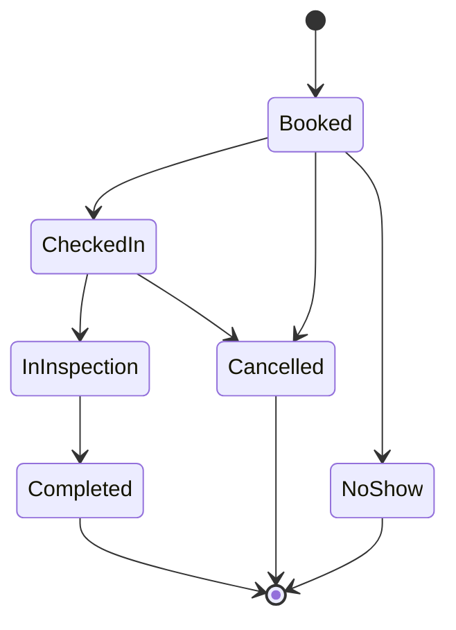

# GarageFlow

A backend API for auto service centers: customers book a service for their vehicle, the system assigns a qualified technician and a free bay, and each appointment moves through check-in and inspection to completion.

> Status: **Day 4**: domain model, appointment state machine, SQL Server in Docker, EF Core mappings and migrations, REST endpoints with Swagger, and JWT login with role-based access. Slot availability comes next.

## Tech stack

C# / .NET 8, ASP.NET Core Web API, EF Core 8, SQL Server 2022 (Docker), xUnit.
JWT bearer authentication with roles. Coming: Hangfire, Docker image for the API, GitHub Actions.

## Architecture

Layered (clean) architecture. Dependencies point inward: the Domain knows nothing about the other layers.

```
GarageFlow.Api  ──►  GarageFlow.Application  ──►  GarageFlow.Domain
      │                                                  ▲
      └──────────►  GarageFlow.Infrastructure ───────────┘
                    (via Application)
```

| Project | Responsibility |
|---|---|
| `GarageFlow.Domain` | Entities, enums, business rules, the appointment state machine. No framework dependencies. |
| `GarageFlow.Application` | Use cases (services), DTOs, validation attributes, and the interfaces Infrastructure implements. |
| `GarageFlow.Infrastructure` | EF Core DbContext, entity mappings, migrations, later repositories and background jobs. |
| `GarageFlow.Api` | Controllers and endpoints, middleware, auth, Swagger. |
| `GarageFlow.Domain.Tests` | xUnit tests for domain rules. |
| `GarageFlow.Infrastructure.Tests` | Tests that check the EF Core mapping without needing a database. |
| `GarageFlow.Application.Tests` | Tests of the booking and customer use cases against an in-memory database. |

## Appointment lifecycle



Rules enforced in the domain:
- Status can only change through methods (`CheckIn`, `StartInspection`, `Complete`, `Cancel`, `MarkNoShow`); illegal moves throw `DomainException`.
- Cancelling requires a reason.
- Inspection items can only be added during inspection, and an appointment cannot be completed without at least one.
- Times are UTC, and overlap checks use half-open intervals (an appointment ending at 10:00 does not clash with one starting at 10:00).

## Database design decisions

- **Restrict, not cascade, on appointment foreign keys.** Deleting a customer or technician must never silently delete appointment history, and cascading from several parents causes SQL Server's "multiple cascade paths" error.
- **Row version on `Appointment`** for optimistic concurrency (used for double-booking prevention).
- **Enums stored as text** so the data is readable in SQL.
- **UTC converter** restores `DateTimeKind.Utc` when reading `datetime2` columns.
- **Secrets stay out of Git:** the SQL Server password lives in `.env` (Docker) and .NET user secrets (the API).

## Getting started

Requires the .NET 8 SDK, Docker Desktop and the EF Core tool (`dotnet tool install --global dotnet-ef --version 8.*`).

```powershell
# 1. Create your local settings (choose your own SQL Server password)
Copy-Item .env.example .env
notepad .env

# 2. Start SQL Server
docker compose up -d

# 3. Give the API the connection string (same password as .env)
dotnet user-secrets set "ConnectionStrings:GarageFlow" "Server=localhost,1433;Database=GarageFlow;User Id=sa;Password=YOUR_PASSWORD;TrustServerCertificate=True" --project src/GarageFlow.Api

# 3b. Give the API a long random signing key for JWT tokens (never commit it)
dotnet user-secrets set "Jwt:SigningKey" "PASTE_A_LONG_RANDOM_STRING_OF_40_OR_MORE_CHARACTERS" --project src/GarageFlow.Api

# 4. Build, test, create the database (migrations are already committed in Infrastructure/Migrations)
dotnet build
dotnet test
dotnet ef database update --project src/GarageFlow.Infrastructure --startup-project src/GarageFlow.Api

# 5. Run the API (in Development it applies migrations and adds demo data)
dotnet run --project src/GarageFlow.Api
```

Swagger opens at `http://localhost:5080/swagger`. Health checks: `/health` and `/health/db`.

## Demo logins (Development only)

`admin@garageflow.local`, `advisor@garageflow.local`, `tech@garageflow.local`, all with password `Garage@12345`. They are created only when the environment is Development and must never exist anywhere else.

## Roles

| Action | Admin | Advisor | Technician |
|---|:-:|:-:|:-:|
| Log in, read customers, appointments and catalog | yes | yes | yes |
| Create customers and vehicles | yes | yes | no |
| Book, check in, cancel, mark no-show | yes | yes | no |
| Start inspection, add inspection items, complete | yes | no | yes |
| Manage users | yes | no | no |

## Endpoints

| Method and path | Purpose |
|---|---|
| `POST /api/auth/login`, `GET /api/auth/me` | Get a JWT; see what the API read from it |
| `POST /api/users`, `GET /api/users`, `POST /api/users/{id}/deactivate` | User management (Admin only) |
| `GET /api/service-types`, `/api/technicians`, `/api/bays` | Reference data for booking |
| `POST /api/customers`, `GET /api/customers`, `GET /api/customers/{id}` | Create, search and read customers |
| `POST /api/customers/{id}/vehicles` | Register a vehicle |
| `POST /api/appointments` | Book (checks skill, ownership, UTC, clashes) |
| `GET /api/appointments`, `GET /api/appointments/{id}` | List (filter by `fromUtc`, `toUtc`, `status`) and read |
| `POST /api/appointments/{id}/check-in`, `start-inspection`, `inspection-items`, `complete`, `cancel`, `no-show` | Move through the lifecycle |

Errors use the standard problem-details JSON: 400 (invalid input or broken rule), 401 (no or bad token, failed login), 403 (wrong role), 404, 409 (clash or duplicate).

## Roadmap

1. Domain model and state machine (done)
2. SQL Server in Docker, EF Core mappings, migrations (done)
3. CRUD endpoints, DTOs, validation, seed data, Swagger (done)
4. JWT authentication and roles: Admin, Advisor, Technician (done)
5. Slot availability
6. Double-booking prevention (transactions and optimistic concurrency)
7. Cancellation, rescheduling, waitlist
8. Background jobs (reminders, no-show marking)
9. Error handling, logging, pagination, audit trail
10. Integration tests, Docker image for the API, GitHub Actions
11. Deployment to Azure
