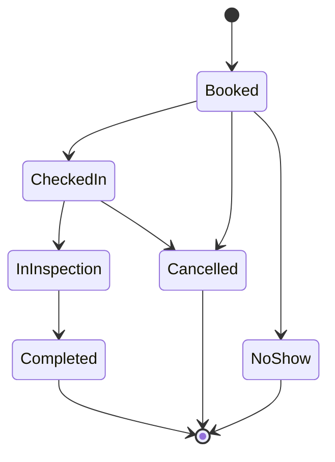

# GarageFlow

A backend API for auto service centers: customers book a service for their vehicle, the system assigns a qualified technician and a free bay, and each appointment moves through check-in and inspection to completion.

> Status: **Day 1 of 11**: solution structure, domain model and appointment state machine. API endpoints, database and auth come next.

## Tech stack

C# / .NET 8, ASP.NET Core Web API, EF Core, SQL Server (Docker), JWT auth, xUnit, Docker, GitHub Actions.
(Only the domain, tests and a health endpoint exist so far; the rest is added day by day.)

## Architecture

Layered (clean) architecture. Dependencies point inward: the Domain knows nothing about the other layers.

```
GarageFlow.Api  ──►  GarageFlow.Application  ──►  GarageFlow.Domain
      │                                                  ▲
      └──────────►  GarageFlow.Infrastructure ───────────┘
                    (via Application)
```

| Project | Responsibility |
|---|---|
| `GarageFlow.Domain` | Entities, enums, business rules, the appointment state machine. No framework dependencies. |
| `GarageFlow.Application` | Use cases, DTOs, validation, interfaces (arrives Day 2+). |
| `GarageFlow.Infrastructure` | EF Core, SQL Server, repositories, background jobs (arrives Day 2+). |
| `GarageFlow.Api` | Controllers, middleware, auth, Swagger. |
| `GarageFlow.Domain.Tests` | xUnit tests for domain rules. |

## Appointment lifecycle



Rules enforced in the domain:
- Status can only change through methods (`CheckIn`, `StartInspection`, `Complete`, `Cancel`, `MarkNoShow`); illegal moves throw `DomainException`.
- Cancelling requires a reason.
- Inspection items can only be added during inspection, and an appointment cannot be completed without at least one.
- Times are UTC, and overlap checks use half-open intervals (an appointment ending at 10:00 does not clash with one starting at 10:00).

## Getting started

Requires the .NET 8 SDK.

```powershell
dotnet new sln -n GarageFlow
dotnet sln add src/GarageFlow.Domain src/GarageFlow.Application src/GarageFlow.Infrastructure src/GarageFlow.Api tests/GarageFlow.Domain.Tests
dotnet build
dotnet test
dotnet run --project src/GarageFlow.Api
```

Then open the URL printed in the console and add `/health`.

## Roadmap

1. Domain model and state machine (done)
2. EF Core, migrations, SQL Server in Docker
3. CRUD endpoints and validation
4. JWT authentication and roles (Admin, Advisor, Technician)
5. Slot availability
6. Double-booking prevention (transactions and optimistic concurrency)
7. Cancellation, rescheduling, waitlist
8. Background jobs (reminders, no-show marking)
9. Error handling, logging, pagination, audit trail
10. Unit and integration tests, Docker Compose, GitHub Actions
11. Deployment to Azure
