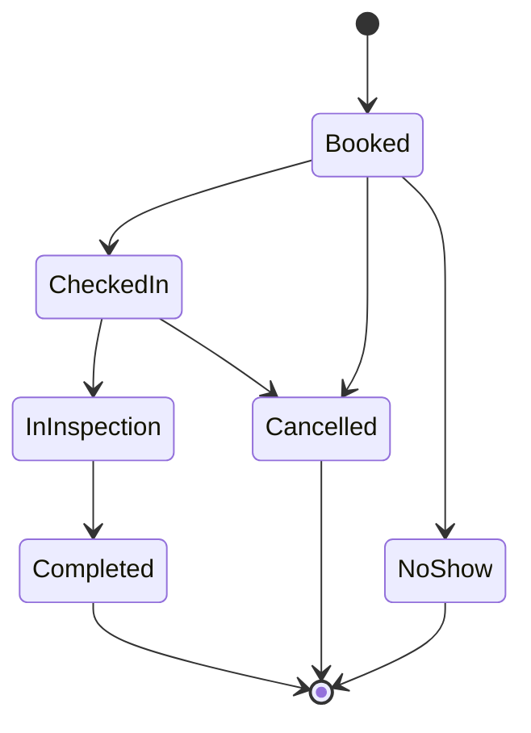

# GarageFlow

A backend API for auto service centers: customers book a service for their vehicle, the system assigns a qualified technician and a free bay, and each appointment moves through check-in and inspection to completion.

> Status: **Day 11**: domain model, appointment state machine, SQL Server in Docker, EF Core mappings and migrations, REST endpoints with Swagger, JWT login with roles, slot availability with automatic assignment, and double-booking protection (transaction lock, unique indexes, row version) proven by parallel integration tests. Day 7 adds a cancellation notice policy, rescheduling under the same lock, and a waitlist that is offered freed slots. Day 8 adds background jobs: no-show marking, reminders, and waitlist offer notices and expiry. Day 9 adds pagination, an automatic audit trail, correlation IDs, request logging and consistent error bodies. Day 10 adds end-to-end API tests, a Docker image and GitHub Actions CI. Day 11 makes it deployable: Admin endpoints to set up the shop, a first-run bootstrap for an empty production database, Swagger off by default, CORS allow-list, login rate limiting and proxy support, plus an Azure deployment guide.

## Tech stack

C# / .NET 8, ASP.NET Core Web API, EF Core 8, SQL Server 2022 (Docker), xUnit.
JWT bearer authentication with roles. Coming: Hangfire, Docker image for the API, GitHub Actions.

## Architecture

Layered (clean) architecture. Dependencies point inward: the Domain knows nothing about the other layers.

```
GarageFlow.Api  ──►  GarageFlow.Application  ──►  GarageFlow.Domain
      │                                                  ▲
      └──────────►  GarageFlow.Infrastructure ───────────┘
                    (via Application)
```

| Project | Responsibility |
|---|---|
| `GarageFlow.Domain` | Entities, enums, business rules, the appointment state machine. No framework dependencies. |
| `GarageFlow.Application` | Use cases (services), DTOs, validation attributes, and the interfaces Infrastructure implements. |
| `GarageFlow.Infrastructure` | EF Core DbContext, entity mappings, migrations, later repositories and background jobs. |
| `GarageFlow.Api` | Controllers and endpoints, middleware, auth, Swagger. |
| `GarageFlow.Domain.Tests` | xUnit tests for domain rules. |
| `GarageFlow.Infrastructure.Tests` | Tests that check the EF Core mapping without needing a database. |
| `GarageFlow.Application.Tests` | Tests of the booking and customer use cases against an in-memory database. |

## Time handling

Appointments are stored and exchanged in UTC (send times with a `Z`). Each shop has a time zone (`Asia/Kolkata` by default) and its opening hours are local times in that zone, so the same rule works correctly across daylight saving changes.

## Concurrency

Two requests booking the same technician at the same moment must never both succeed. Booking runs inside a database transaction that holds a SQL Server application lock per shop (`IBookingGate`), so "check it is free" and "take it" are one step. Two filtered unique indexes are a second line of defence inside the database, and `Appointment.RowVersion` detects two people editing the same appointment (HTTP 409). Parallel integration tests against the real SQL Server prove it.

## Waitlist

When a booking is cancelled or moved, the oldest waiting customer whose window contains the freed start (and whose service fits and can be done by the freed technician) is **offered** the slot. Accepting books a real appointment through the normal booking path and lock; if the slot was taken meanwhile the customer returns to the queue. See `docs/day-7-study-notes.md`.

## Background jobs

A hosted worker (`MaintenanceWorker`) runs every minute and calls `MaintenanceService`:

- **No-shows:** a Booked appointment not checked in 30 minutes after its start becomes `NoShow`.
- **Reminders:** appointments within 24 hours get one notification (sent first, recorded after, so a failure retries).
- **Waitlist:** offers are announced once, expire after 2 hours, and an expired offer is passed to the next customer if the slot is still free.

Jobs are idempotent (each records its result on the row) and tolerate races through the row version. Notifications go through `INotificationSender`; today it logs. Settings live under `Maintenance` in `appsettings.json`. See `docs/day-8-study-notes.md`.

## Pagination, audit trail and logging

- Lists are paged (`?page=1&pageSize=20`, max 100) with a stable sort (tie-broken by `Id`) and return `items`, `totalCount`, `totalPages`, `hasNext`.
- Every change to appointments, inspection items, waitlist entries, customers, vehicles and users is written to `AuditLogs` (who, what, from/to, when) in the same transaction as the change. Password hashes are never recorded. Background jobs show as `system`.
- Every response carries `X-Correlation-ID`; error bodies include `correlationId`, and every log line for the request carries it. One log line per request. 500 responses never reveal internals.

See `docs/day-9-study-notes.md`.

## Appointment lifecycle



Rules enforced in the domain:
- Status can only change through methods (`CheckIn`, `StartInspection`, `Complete`, `Cancel`, `MarkNoShow`); illegal moves throw `DomainException`.
- Cancelling requires a reason. A Booked appointment cannot be cancelled or rescheduled less than 2 hours before it starts, unless an Admin overrides (`allowLate`).
- Inspection items can only be added during inspection, and an appointment cannot be completed without at least one.
- Times are UTC, and overlap checks use half-open intervals (an appointment ending at 10:00 does not clash with one starting at 10:00).

## Database design decisions

- **Restrict, not cascade, on appointment foreign keys.** Deleting a customer or technician must never silently delete appointment history, and cascading from several parents causes SQL Server's "multiple cascade paths" error.
- **Row version on `Appointment`** for optimistic concurrency (used for double-booking prevention).
- **Enums stored as text** so the data is readable in SQL.
- **UTC converter** restores `DateTimeKind.Utc` when reading `datetime2` columns.
- **Secrets stay out of Git:** the SQL Server password lives in `.env` (Docker) and .NET user secrets (the API).

## Getting started

Requires the .NET 8 SDK, Docker Desktop and the EF Core tool (`dotnet tool install --global dotnet-ef --version 8.*`).

```powershell
# 1. Create your local settings (choose your own SQL Server password)
Copy-Item .env.example .env
notepad .env

# 2. Start SQL Server
docker compose up -d

# 3. Give the API the connection string (same password as .env)
dotnet user-secrets set "ConnectionStrings:GarageFlow" "Server=localhost,1433;Database=GarageFlow;User Id=sa;Password=YOUR_PASSWORD;TrustServerCertificate=True" --project src/GarageFlow.Api

# 3b. Give the API a long random signing key for JWT tokens (never commit it)
dotnet user-secrets set "Jwt:SigningKey" "PASTE_A_LONG_RANDOM_STRING_OF_40_OR_MORE_CHARACTERS" --project src/GarageFlow.Api

# 4. Build, test, create the database (migrations are already committed in Infrastructure/Migrations)
dotnet build
dotnet test
dotnet ef database update --project src/GarageFlow.Infrastructure --startup-project src/GarageFlow.Api

# 5. Run the API (in Development it applies migrations and adds demo data)
dotnet run --project src/GarageFlow.Api
```

Swagger opens at `http://localhost:5080/swagger`. Health checks: `/health` and `/health/db`.

## Front end (Angular)

A single-page app in `web/`: Angular 19, standalone components, signals, reactive forms, lazy routes. Screens: login with roles, a bay board for the day, appointments and their lifecycle, booking with live availability, customers and cars, waitlist, audit trail, and admin pages for shop setup, users and maintenance. Times are shown in the shop's time zone, not the browser's.

```powershell
# API running on http://localhost:5080 (Development), then:
cd web
npm install
npm start            # http://localhost:4200, /api is proxied to the API
npm run test:ci      # unit tests (needs Chrome)
npm run build

# or everything in containers, one origin, no CORS:
docker compose --profile api --profile web up --build -d    # http://localhost:8081
```

Details and design decisions: [docs/frontend-notes.md](docs/frontend-notes.md).

## Docker and CI

```powershell
# Add JWT_SIGNING_KEY=<40+ random characters> to .env first, then run SQL Server AND the API in containers:
docker compose --profile api up --build -d
# Swagger: http://localhost:5080/swagger   (stop with: docker compose --profile api down)
```
`docker compose up -d` (no profile) still starts only SQL Server, for local development. The `Dockerfile` is multi-stage and runs as a non-root user; secrets come in as environment variables, never baked into the image. GitHub Actions (`.github/workflows/ci.yml`) builds, runs every test against a real SQL Server container, and builds the image on each push. See `docs/day-10-study-notes.md`.

## Production setup

A real environment has no demo data or demo users. On its first start (with `Database__MigrateOnStartup=true` and any environment other than Development) the API creates the shop with the standard services and **one Admin** from configuration, then does nothing on later starts:

| Setting (environment variable) | Meaning |
|---|---|
| `Bootstrap__AdminEmail`, `Bootstrap__AdminPassword` | First Admin (password 12+ characters; remove it from the environment afterwards) |
| `Bootstrap__ShopName`, `OpeningTime`, `ClosingTime`, `TimeZoneId` | The shop record |
| `Swagger__Enabled` | Swagger is off outside Development unless `true` |
| `Cors__AllowedOrigins__0`, `__1`... | Websites allowed to call the API from a browser (none by default) |
| `RateLimiting__LoginPermitLimit`, `LoginWindowSeconds` | Login attempts per address per window (default 10 per 60 s, then 429) |
| `Hosting__BehindProxy` | `true` when a load balancer sits in front, so the real caller address is used |

The Admin then adds technicians and bays with `POST /api/technicians` and `/api/bays`. Step-by-step Azure commands are in `docs/deploy-azure.md`; the reasoning is in `docs/day-11-study-notes.md`.

## Running the tests

```powershell
dotnet test                                                       # everything; integration tests are skipped if SQL Server is not running
dotnet test --filter "FullyQualifiedName!~IntegrationTests"       # fast unit tests only
dotnet test --filter DoubleBookingTests                           # only the parallel booking tests (need docker compose up -d)
dotnet test --filter ApiEndpointTests                             # end-to-end HTTP tests of the whole API (need docker compose up -d)
```

The integration tests use the API's connection string from user secrets (or the `GARAGEFLOW_TEST_SQL` environment variable) and create and delete their own temporary databases.

## Demo logins (Development only)

`admin@garageflow.local`, `advisor@garageflow.local`, `tech@garageflow.local`, all with password `Garage@12345`. They are created only when the environment is Development and must never exist anywhere else.

## Roles

| Action | Admin | Advisor | Technician |
|---|:-:|:-:|:-:|
| Log in, read customers, appointments and catalog | yes | yes | yes |
| Create customers and vehicles | yes | yes | no |
| Book, reschedule, check in, cancel, mark no-show, use the waitlist | yes | yes | no |
| Override the 2-hour notice rule (`allowLate`) | yes | no | no |
| Start inspection, add inspection items, complete | yes | no | yes |
| Manage users, read the full audit trail, run jobs | yes | no | no |
| See one appointment's history | yes | yes | no |

## Endpoints

| Method and path | Purpose |
|---|---|
| `POST /api/auth/login`, `GET /api/auth/me` | Get a JWT; see what the API read from it |
| `POST /api/users`, `GET /api/users`, `POST /api/users/{id}/deactivate` | User management (Admin only) |
| `GET /api/availability?serviceTypeId=&date=` | Free start times for a service on a day (shop's local date), with who and what is free |
| `GET /api/service-types`, `/api/technicians`, `/api/bays` | Reference data for booking |
| `POST /api/technicians`, `/api/bays`, `/api/service-types` | Set the shop up (Admin only) |
| `POST /api/customers`, `GET /api/customers`, `GET /api/customers/{id}` | Create, search and read customers |
| `POST /api/customers/{id}/vehicles` | Register a vehicle |
| `POST /api/appointments` | Book (checks skill, ownership, UTC, opening hours, clashes). Leave `technicianId` / `bayId` empty to have them assigned |
| `GET /api/appointments`, `GET /api/appointments/{id}` | List (filter by `fromUtc`, `toUtc`, `status`; paged with `page`, `pageSize`) and read |
| `GET /api/appointments/{id}/history`, `GET /api/audit` | Who did what and when (history: Admin/Advisor; full audit with filters: Admin) |
| `POST /api/appointments/{id}/reschedule` | Move a Booked appointment (same rules and lock as booking; keeps technician and bay if free) |
| `POST /api/waitlist`, `GET /api/waitlist?status=` | Ask to be told when a slot opens; see the queue |
| `POST /api/waitlist/{id}/accept`, `/cancel` | Turn an offered slot into a booking; leave the queue |
| `POST /api/maintenance/run` | Admin only: run the background jobs now and see how many items each handled |
| `POST /api/appointments/{id}/check-in`, `start-inspection`, `inspection-items`, `complete`, `cancel`, `no-show` | Move through the lifecycle |

Errors use the standard problem-details JSON: 400 (invalid input or broken rule), 401 (no or bad token, failed login), 403 (wrong role), 404, 409 (clash or duplicate).

## Roadmap

1. Domain model and state machine (done)
2. SQL Server in Docker, EF Core mappings, migrations (done)
3. CRUD endpoints, DTOs, validation, seed data, Swagger (done)
4. JWT authentication and roles: Admin, Advisor, Technician (done)
5. Slot availability and automatic assignment (done)
6. Double-booking prevention: transactions, lock, unique indexes, optimistic concurrency (done)
7. Cancellation, rescheduling, waitlist (done)
8. Background jobs: reminders, no-show marking, offer expiry (done)
9. Error handling, logging, pagination, audit trail (done)
10. API integration tests, Docker image for the API, GitHub Actions (done)
11. Production readiness: bootstrap, hardening, deploy guide (done; live Azure deployment is a guide, not yet run)
